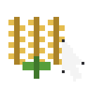

# RightClickHarvest



Right-click a **ripe** crop with an **empty hand**: it is harvested and sown
again in one click, if you carry the seed for it.

| Crop | Ripe at `age` | Sown back with |
|---|---|---|
| `minecraft:wheat` | 7 | `minecraft:wheat_seeds` |
| `minecraft:carrots` | 7 | `minecraft:carrot` |
| `minecraft:potatoes` | 7 | `minecraft:potato` |
| `minecraft:beetroots` | 3 | `minecraft:beetroot_seeds` |
| `minecraft:nether_wart` | 3 | `minecraft:nether_wart` |

The harvest is the game's own player break (`Game::break_block_as_player`), so
drops, loot tables, statistics, exhaustion, sound and particles are the vanilla
ones; the crop is then set back to `age = 0` and one seed is taken from the
inventory. In creative nothing is taken (a creative break drops nothing either).

## What it does not do

- Growing crops (`age` below the maximum) are untouched — vanilla behaviour.
- Other blocks, including ones with an inventory (chests, furnaces), are
  untouched: only the block ids above are considered.
- A non-empty hand is untouched: your hoe, seeds, bone meal and everything else
  keep their own use, in both hands.
- No seed in the inventory: the crop is still harvested, the plot stays empty.
  The seeds that just dropped are ordinary item entities — pick them up and
  plant them with them; the mod does not pull a seed back out of a drop, and it
  does not sow from the off hand.
- No client-side prediction: joining a server, the harvest happens on the server
  and the crop's new state arrives as a block update (the game already sends
  one for the clicked block).
- Spectators act on nothing, as in vanilla.

## How it is hooked

`mixins/rightharvest/horizon-mixin.toml`:

- `[[module]] runtime` — `runtime.rs` becomes `crate::game::native_rightharvest`.
- `[[injection]] block-use` — `HEAD` on the **named hook**
  `right_click_block` (API 21): a player's right click on a block, before the
  block's own use and the item's, on the game that owns the world: the single
  player server's, a LAN host's, a dedicated server's. The client's own dry
  prediction (`remote_use_item_on` in `game/remote.rs`) is a different function
  and is not touched. Setting `canceled` makes the click stop there, exactly
  like a vanilla use that acted. The hook first asks
  `native_on("rightharvest")`, so turning the mod off in Options > Mods makes
  every click vanilla again without a rebuild.
- `[[injection]] listed` — `HEAD` on `native_hooks::Game::native_mods`: the
  mod's row in Options > Mods.

`harvest.rs` reads the block under the crosshair, asks `runtime.rs` whether it
is a ripe crop, and if so breaks it, spends a seed and sets it back. All the
decisions (which block, which age, which seed) are in `runtime.rs`, which is
also a standalone crate, so they are unit-tested without the game.

## Build and enable

The launcher builds native mods; the mod plays in the instance built for it.

1. Launcher → Mods → install the bundle (or `horizon-launcher native-build
   E:/Projects/hz-mods/rightharvest --instance NAME --trust-native-code`).
2. The first build installs Rust and turns on Settings → Game → **Native mods
   (experimental)**; press **Build** and accept the warning.
3. In game: **Options → Mods** lists `rightharvest`; leave it on. Turn it off
   there to stop the hook from acting (the code stays built in).

Pinned to Horizon `fdc87aecdbd116bf1e08adcd062fcbaea8c2e2ca` (the commit in
`[compatibility]`, the 2026-11-08 Nightly). Both hook points are named, so a
Horizon update that moves the source under them does not break the bundle. The
helper still calls private game methods (`break_block_as_player`, `level_set`,
`with_props`), so an update can change their shape: rebuild and re-check
`horizon-mixins plan` after one.

## Check it without the game

```sh
export PATH="<launcher>/rust/1.99.1-x86_64-pc-windows-gnu/bin:<launcher>/rust/1.99.1-x86_64-pc-windows-gnu/mingw64/bin:$PATH"
export CARGO_HOME=<launcher>/cargo CARGO_TARGET_DIR=E:/Projects/hz-mods/rightharvest/target
cargo test          # the pure logic: ripeness, ages, seeds, the negative cases
cargo clippy --all-targets -- -D warnings
cargo fmt --check

horizon-mixins.exe plan  --workspace <source> --mods mixins --out build/plan.json
horizon-mixins.exe apply --workspace <source> --mods mixins --out build/stage
```

`harvest.rs` itself is only compiled inside the game (it reads `Game`'s private
fields), so `plan`/`apply` and a game build are its checks. See `PROOF.md`.
